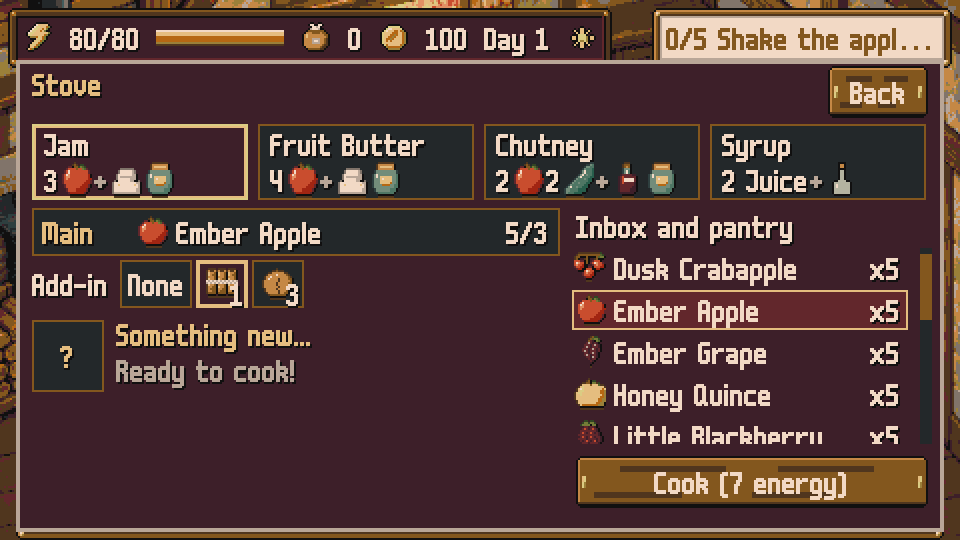
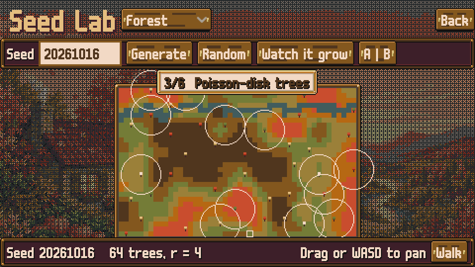

# Autumn Preserves

*Put autumn in a jar.*

A cozy pixel-art game about **Granny Tonty**, who lives in **Everfall**, a small valley where autumn never ends. Outside the valley it is winter, so she fills jars with the endless autumn and sends them to everyone who needs them: her grandchildren in the city and her neighbours in town.

Made by **İzzet Emre Demir** for the **KODTÜ 7** game jam (16–18 October 2026).

| | |
|---|---|
|  |  |
|  |  |
|  |  |
|  |  |

## How it plays

- **Explore and forage.** Every morning the wild is generated anew from a seed. Shake fruit trees, pick blackberries, find mushroom rings and rare varieties. Squirrels, hedgehogs, birds and frogs live in the wild. From day 8 a **harvest calendar** (Grape Harvest, Apple Moon, First Frost) favours that week's ingredients, and windy and foggy days join sun and rain. Besides the forest there is a **vineyard** (open it by befriending the vintner) and a **creek** (buy the boots at the grocer). The garden gate asks where to go once a second wild is open.
- **Grow a garden.** Plant vegetables in the beds, feed the compost and say hello to **Granny's cat**, who naps in a different spot every day.
- **Cook and preserve.** Turn what you gather into jams, chutneys, pickles, brines, syrup and sauerkraut through small kitchen mini-games. The **press** and the **dough board** add juice, vinegar, pies and bread. Cook a recipe well three times and it is **mastered**: batch-cook it without the mini-game. The **big pot** fills two jars at once, and the grandchildren send back six **family recipes** as their love grows. Every recipe, ingredient variety and add-in combination becomes a procedurally generated preserve with its own name, jar, taste profile and value.
- **Keep a tidy pantry.** Arrange your jars on the shelves like a little puzzle. The right shelf keeps food fresh, and a beautiful pantry gives Granny more energy the next morning.
- **Share it.** Fill the orders of **five neighbours** by taste ("something sweet and spicy"), sell at the grocer, set up the **weekly market** stall (every seventh day), where five vendors and a crowd of villagers, each assembled from hand-drawn parts and recoloured from a seed, walk their routes around your stall, and fill your recipe book.
- **Write to the grandchildren.** Mia and Leo send **letters** with a crayon drawing and a wish. Pack a **parcel** with care and they write back.
- **Peek into the Forest Lab.** Type any seed, pick a biome and watch the wild being built step by step: value noise, random-walk stream, Poisson-disk trees, A* paths, weighted pickups, flood-fill check.

No death, no penalties, no clock. Days end when you go to bed. If you stay long enough, the valley has one quiet surprise.

**English or Turkish:** pick the language in Settings. Turkish procedural names follow vowel harmony (*Tarçınlı*, *Cevizli*, *Elma Reçeli*).

## Controls

| Action | Mouse / touch | Keyboard |
|---|---|---|
| Walk | Click or tap the ground | W A S D or arrow keys |
| Use, pick, talk, shake a tree | Click or tap it | E or Enter |
| Open the recipe book | | B |
| Rotate a pie or bread on the shelf | Right click or two-finger tap | R |
| Stir, press, knead | Circle the pot, click or tap | Space (skim with E) |
| Back out of a screen | Back button | Esc |
| Sound on / off | | M |

Everything is playable with the mouse alone.

## Jam constraints

| Constraint | In the game |
|---|---|
| Pixelated art style | Everything is pixel art at 480×270 with integer scaling |
| Autumn colour palette | One 31-colour palette: [Vintage Autumn](https://lospec.com/palette-list/vintage-autumn) by Goopy25 |
| Procedural generation | Daily forest maps, per-save ingredient varieties, generated preserves (name, jar art, taste, value, Turkish names), orders, weather, wild critters, market villagers and crowd routes, and children's drawings. The seed is always visible and can be explored in the **Forest Lab** |

## Run it

**Builds** for macOS and Windows are on the repository's **GitHub Releases** page. To present from a release build, use **Settings → Demo day**: a ready rainy day that leaves your own save untouched. The macOS build is unsigned: right-click the app and choose Open the first time. The game saves locally and needs no network.

**From source**

1. Install [Godot 4.7](https://godotengine.org/).
2. Open `game/project.godot` in the editor and press Play, or run `godot --path game`.
3. Development builds start muted: press **M** to turn sound on, or run `godot --path game -- --sound`. Exported builds play sound.

In the **Forest Lab** (title screen) a seed can be a number or a word; the same seed always gives the same map.

## License

- **Code** (GDScript, shaders, Python tools): MIT, see [LICENSE](LICENSE).
- **Art and audio:** © 2026 İzzet Emre Demir, all rights reserved.
- Fonts and palette keep their own licenses, see [CREDITS.md](CREDITS.md).
