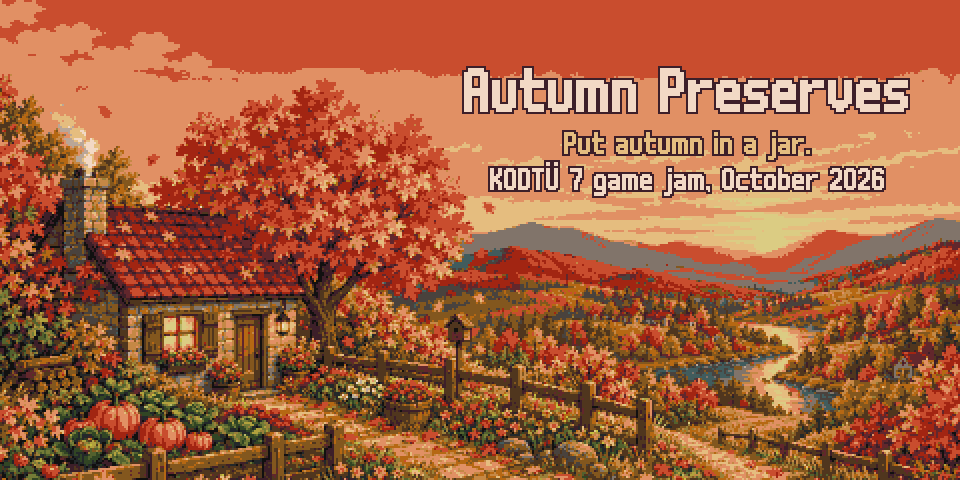
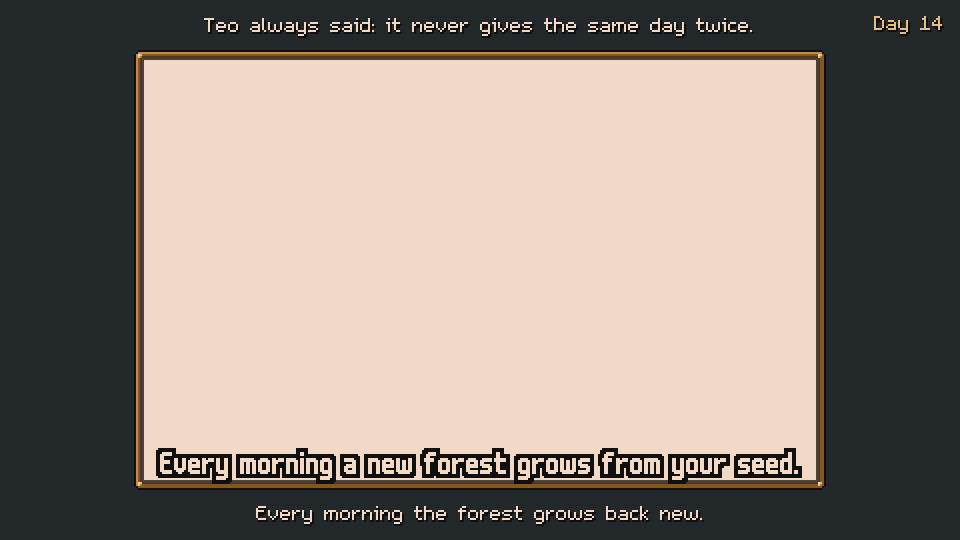

  

  <b>A cozy pixel-art game about a grandma who puts an endless autumn in jars.</b> 
  Every forest, every ingredient and every jar is procedurally generated from one seed.

  
  
  
  
  
  

  

Outside the valley of **Everfall** it is winter. Inside, autumn never ends. **Granny Tonty** forages in a forest that did not exist yesterday, cooks what she finds into jams, juices, pickles and pies, arranges the jars on her pantry shelves and shares them with her neighbours, the weekly market and her grandchildren in the city.

Made by **İzzet Emre Demir** for the **KODTÜ 7** game jam (16–18 October 2026).

## Try it in ten minutes

Open the game and press **Harvest Festival** on the title screen. Mia and Leo are visiting, the market is open and everything is unlocked: six small jobs show every system in about ten minutes, and your own save is never touched. The festival ends with a card that tells you which seed your world grew from.

## Highlights

- 🌲 **A new forest every morning.** Value noise, a random-walk stream, Poisson-disk trees, A* paths and weighted pickups, checked by a flood fill so every tree and mushroom can be reached. The same seed always grows the same forest.
- 🫙 **Every jar is generated.** Name, label, jar art, five-axis taste, harmony stars and value come from the recipe, the ingredient variety and the add-in. *Cinnamon Ember Crabapple Jam* is sweet and sour, scores five stars and is worth 233 coins; nobody wrote that by hand.
- 🍳 **Short kitchen mini-games.** Stir the pot, pack the jar, press the juice, knead the dough: about twenty seconds each.
- 🧺 **A pantry puzzle.** The right shelf keeps food fresh, kinds belong together and a pretty shelf earns a third star.
- 🏡 **A living village.** Five neighbours with orders and gifts, a weekly market with five vendors and a crowd of villagers assembled from hand-drawn parts and recoloured from the seed, and letters from the grandchildren with their crayon drawings.
- 🍂 **No death, no penalties, no clock.** A day ends when Granny goes to bed. Stay long enough and the valley has one quiet surprise.
- 🇹🇷 **English or Turkish.** Turkish jar names follow vowel harmony: *Tarçınlı*, *Cevizli*, *Elma Reçeli*.

## Screenshots

| | |
|---|---|
|  |  |
|  |  |
|  |  |
|  |  |

## Jam constraints

| Constraint | In the game |
|---|---|
| Pixelated art style | Everything is pixel art at 480×270, scaled by whole numbers only |
| Autumn colour palette | One 31-colour palette, [Vintage Autumn](https://lospec.com/palette-list/vintage-autumn) by Goopy25; every sprite is checked against it automatically |
| Procedural generation | Daily forests in three biomes, ingredient varieties per save, preserves (name, jar art, taste, value, Turkish grammar), orders, weather, critters, market villagers and their routes, children's drawings. The seed is always on screen |

## Controls

| Action | Mouse / touch | Keyboard |
|---|---|---|
| Walk | Click or tap the ground | W A S D or arrow keys |
| Use, pick, talk, shake a tree | Click or tap it | E or Enter |
| Recipe book | | B |
| Rotate a pie or bread on the shelf | Right click | R |
| Stir, press, knead | Circle the pot, click or tap | Space (skim with E) |
| Menu: settings, back to title, quit | The gear in the top bar | Esc |
| Sound on / off | | M |

Everything is playable with the mouse alone.

## Run it

**Builds** for macOS, Windows and the web are on the [Releases](https://github.com/izzetemredemir/autumn-preserves/releases) page. The macOS build is unsigned: right-click the app and choose Open the first time. The game saves locally and needs no network.

<b>From source</b>

1. Install [Godot 4.7](https://godotengine.org/).
2. Open `game/project.godot` and press Play, or run `godot --path game`.
3. Development builds start muted: press **M**, or run `godot --path game -- --sound`. Exported builds play sound.

<b>Behind the scenes: the Forest Lab</b>

Press **L** on the title screen to open the Forest Lab. Type any number or word as a seed, pick a biome and press **G** to watch the forest being built step by step: noise, stream, Poisson-disk trees (with their rejection circles), A* paths, pickups and the flood-fill check. **C** compares two seeds side by side.

## Credits and license

- **Design, code, art direction:** İzzet Emre Demir.
- **Fonts:** m5x7 and m6x11 by Daniel Linssen. **Palette:** Vintage Autumn by Goopy25. Some art and audio were generated with AI image and music models, then reduced to the palette and edited by hand; see [CREDITS.md](CREDITS.md).
- **Code** (GDScript, shaders, Python tools): MIT, see [LICENSE](LICENSE).
- **Art and audio:** © 2026 İzzet Emre Demir, all rights reserved. They are not covered by the MIT license.
