

  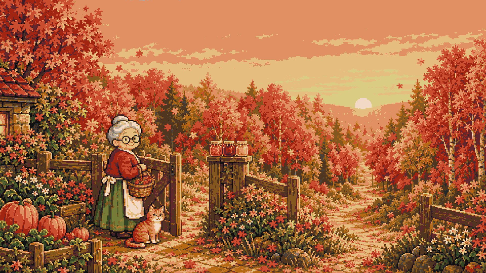

<h1 align="center">Autumn Preserves</h1>

  <b>A cozy pixel-art game about a grandma who puts autumn in jars for the ones living through winter.</b> 
  Every forest, every ingredient and every jar is procedurally generated from one seed.

  
  
  

  <b>Play:</b> <a href="https://izzetemredemir.github.io/autumn-preserves/">in your browser</a> (plays in the browser on desktop; on a phone hold it landscape) 
  <b>Download:</b>
  <a href="https://github.com/izzetemredemir/autumn-preserves/releases/latest/download/AutumnPreserves.zip">macOS (zip)</a> ·
  <a href="https://github.com/izzetemredemir/autumn-preserves/releases/latest/download/AutumnPreserves.exe">Windows (exe)</a>

  <b>macOS 15+:</b> the app is not notarised: System Settings → Privacy &amp; Security → Open Anyway (or <code>xattr -cr "Autumn Preserves.app"</code>). 
  <b>Windows:</b> SmartScreen: More info → Run anyway.

  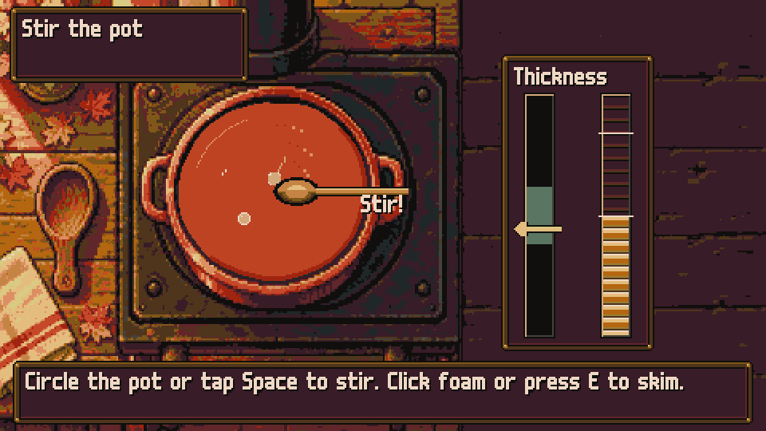

<table align="center">
  <tr><th align="left">Made for the KODTÜ 7 constraints</th></tr>
  <tr><td><b>Pixelated</b>: everything is pixel art at 480×270, scaled by whole numbers only. 
  <b>Autumn palette</b>: one 31-colour palette; every sprite is checked against it automatically. 
  <b>Procedural generation</b>: the same seed grows the same forest twice; every jar is generated (see below).</td></tr>
</table>

  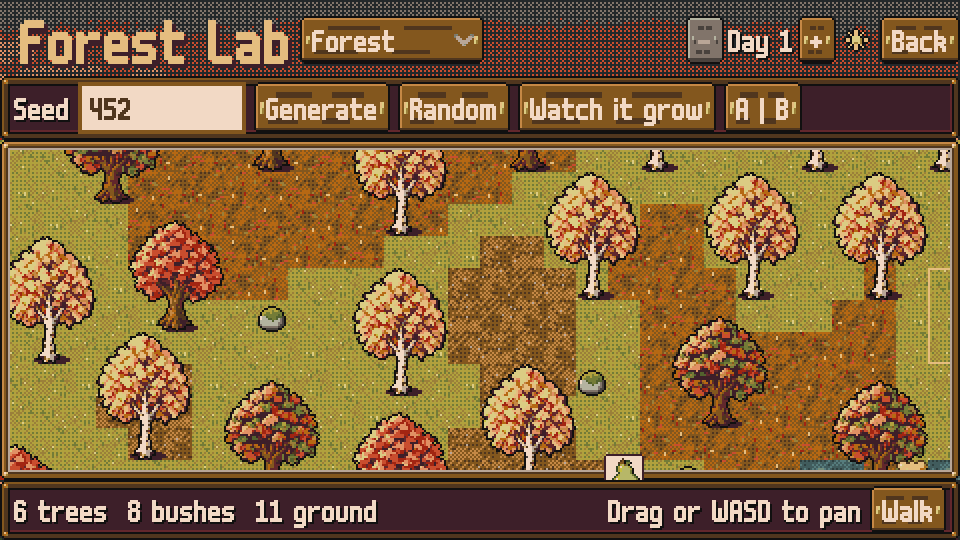 
  <b>Same seed, same forest. New seed, new forest.</b>

   
  <b>Every jar is generated: name, label, taste and value.</b>

   
  <b>New wild species, named and drawn from the seed.</b>

## The story

Outside the valley of **Everfall** it is winter. Inside, autumn stays, for as long as someone keeps giving it away. For fifty years **Granny Tonty** and **Teo** filled their pantry together: he knew the forest, which tree would fruit on which morning and where the mushrooms hid, and she knew the kitchen. Every autumn they sent parcels of jars over the mountain road to their daughter **Nora** and her children, **Mia** and **Leo**, in the city.

This summer Teo died. The shelves are empty and the garden gate has been shut ever since. Then a letter comes from Nora: it snowed in the city this morning, the children keep asking when Granny's jars will come, and *"Send us a little autumn. One jar is enough to start."*

So Tonty opens the gate. The forest grows anew every morning; Teo always said it never gives the same day twice. She cooks what she finds into jams, juices, pickles and pies, arranges the jars on her shelves and shares them with her neighbours, the weekly market and the grandchildren, who write back with crayon drawings. The neighbours remember Teo a little more each time she visits, and somewhere in the old recipe book he left her a letter.

  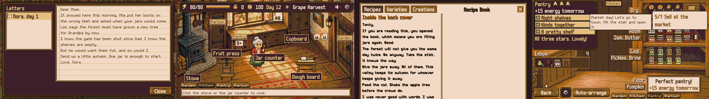 
  Nora's letter · a drawing from Leo on the kitchen wall · Teo's letter in the recipe book · a full pantry

## How it is generated

  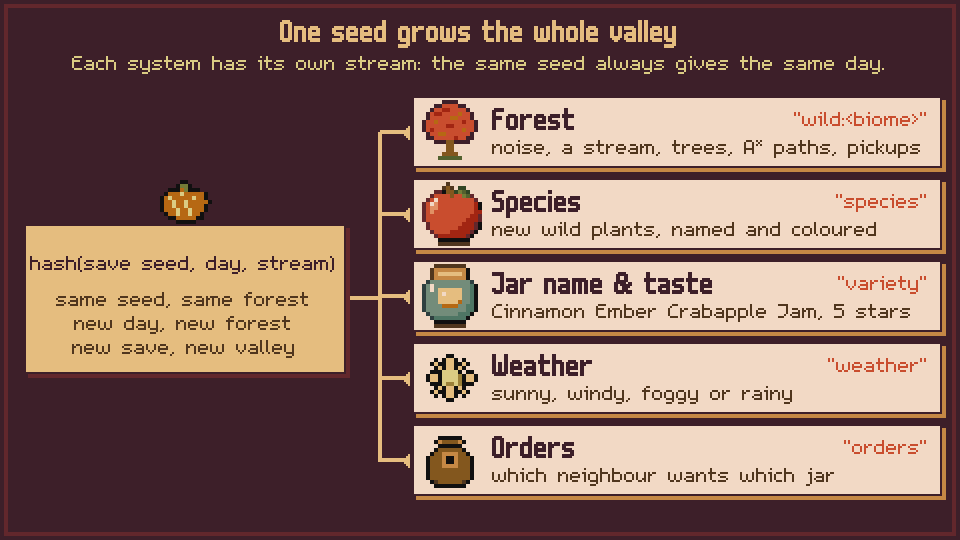

Every system draws from its own random stream, seeded with `hash(save seed, day, stream)`. Changing one system never shifts another, the same seed always grows the same day, and the seed is always on screen.

- **Forest:** value noise, a random-walk stream, Poisson-disk trees, A* paths and weighted pickups, checked by a flood fill so every tree and mushroom can be reached. Three biomes: the forest, a vineyard and a creek.
- **Species and varieties:** each save has its own ingredient varieties, and new wild species (fruits, mushrooms and vegetables) appear in the forest with their own names, colours and tastes.
- **Jars:** name, label, jar art, five-axis taste, harmony stars and value come from the recipe, the variety and the add-in. *Cinnamon Ember Crabapple Jam* is sweet and sour, scores five stars and is worth 233 coins; nobody wrote that by hand. Turkish names follow vowel harmony.
- **Weather, orders and the village:** sunny, windy, foggy or rainy days, neighbours' orders, the market crowd assembled from hand-drawn parts, and the children's drawings.

<b>Watch it happen: the Forest Lab</b>

Press **L** on the title screen to open the Forest Lab. Type any number or word as a seed, pick a biome and press **G** to watch the forest being built step by step: noise, stream, Poisson-disk trees (with their rejection circles), A* paths, pickups and the flood-fill check. **C** compares two seeds side by side.

## Screenshots

| | |
|---|---|
| 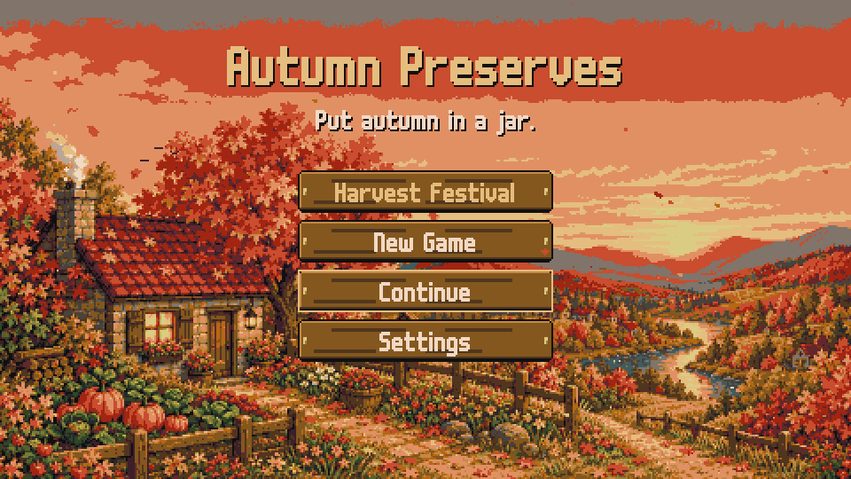 | 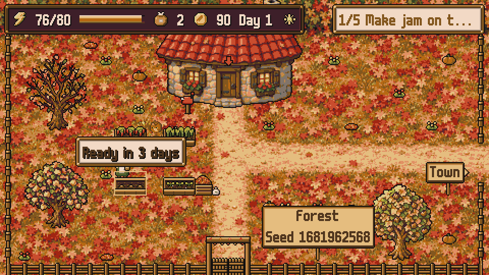 |
| 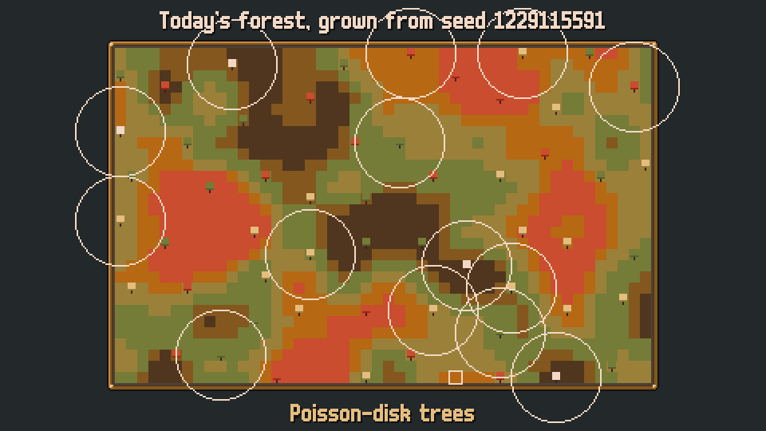 | 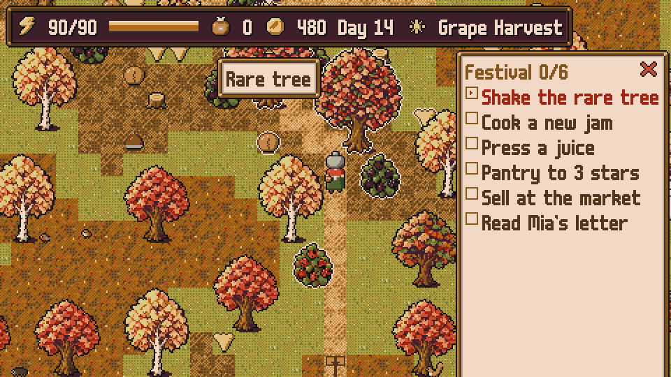 |
| 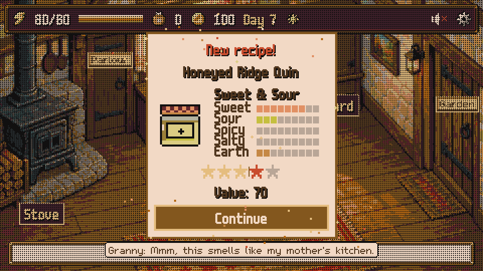 | 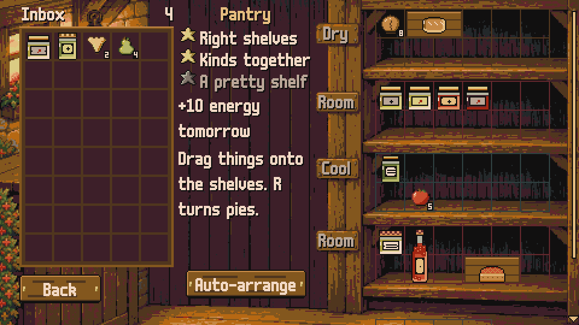 |
| 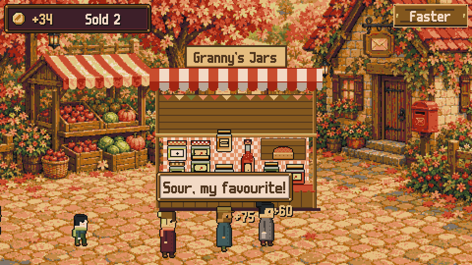 | 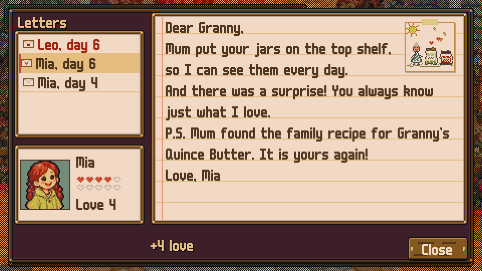 |

## How to play

- **Try it in ten minutes:** press **Harvest Festival** on the title screen. Mia and Leo are visiting, the market is open and everything is unlocked: six small jobs show every system, and your own save is never touched.
- **Forage** in the forest, **cook** in short kitchen mini-games (stir, pack, press, knead), **arrange** the pantry so every jar is on the right shelf, and **share** with neighbours, the market and the grandchildren.
- No death, no penalties, no clock. A day ends when Granny goes to bed.
- Everything is playable with the mouse alone. English or Turkish.

<b>Controls</b>

| Action | Mouse / touch | Keyboard |
|---|---|---|
| Walk | Click or tap the ground | W A S D or arrow keys |
| Use, pick, talk, shake a tree | Click or tap it | E or Enter |
| Recipe book | | B |
| Rotate a pie or bread on the shelf | Right click | R |
| Stir, press, knead | Circle the pot, click or tap | Space (skim with E) |
| Menu: settings, back to title, quit | The gear in the top bar | Esc |
| Sound on / off | | M |

<b>Run it from source</b>

The macOS build is unsigned: right-click the app and choose Open the first time. The game saves locally and needs no network.

1. Install [Godot 4.7](https://godotengine.org/).
2. Open `game/project.godot` and press Play, or run `godot --path game`.
3. Development builds start muted: press **M**, or run `godot --path game -- --sound`. Exported builds play sound.

## Made in 48 hours for KODTÜ 7

Made by one person, **İzzet Emre Demir**, in 48 hours for the **KODTÜ 7** game jam (16–18 October 2026).

| Jam constraint | In the game |
|---|---|
| Pixelated art style | Everything is pixel art at 480×270, scaled by whole numbers only |
| Autumn colour palette | One 31-colour palette, [Vintage Autumn](https://lospec.com/palette-list/vintage-autumn) by Goopy25; every sprite is checked against it automatically |
| Procedural generation | Daily forests in three biomes, ingredient varieties per save, wild species, preserves (name, jar art, taste, value, Turkish grammar), orders, weather, critters, market villagers and their routes, children's drawings |

## Credits and license

- **Design, direction, procedural systems:** İzzet Emre Demir, alone, in 48 hours.
- **Made with:** [Godot 4.7](https://godotengine.org) · [Claude Code](https://claude.com/claude-code) (code, tooling and the asset pipeline, directed by me) · GPT Image via [fal](https://fal.ai) (paintings and sprite sources, every one reduced to the palette and cleaned by hand) · [ElevenLabs](https://elevenlabs.io) (music, sound effects, the video narration) · [Aseprite](https://www.aseprite.org) (pixel edits). AI tools and pre-made assets are allowed by the jam rules; every generated asset is listed in `tools/asset_log.csv`.
- **Fonts:** m5x7 and m6x11 by Daniel Linssen. **Palette:** Vintage Autumn by Goopy25. See [CREDITS.md](CREDITS.md).
- **Code** (GDScript, shaders, Python tools): MIT, see [LICENSE](LICENSE).
- **Art and audio:** © 2026 İzzet Emre Demir, all rights reserved. They are not covered by the MIT license.
